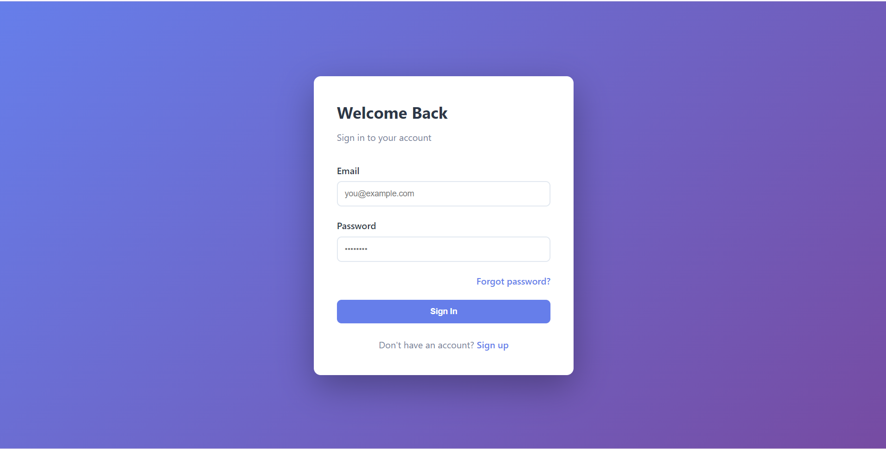
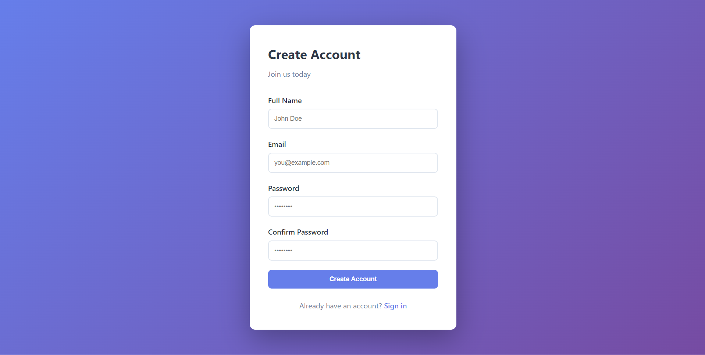
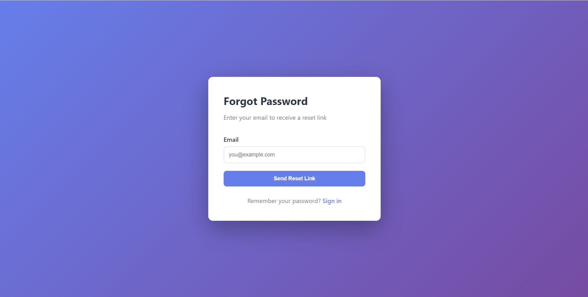
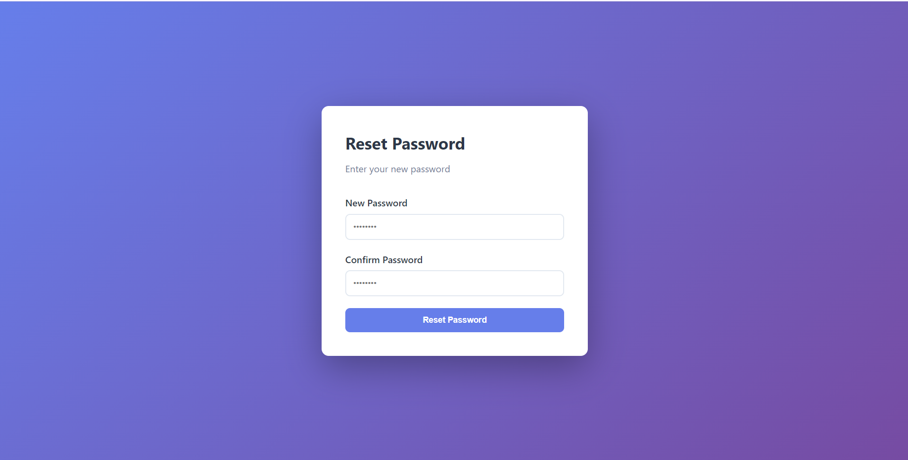
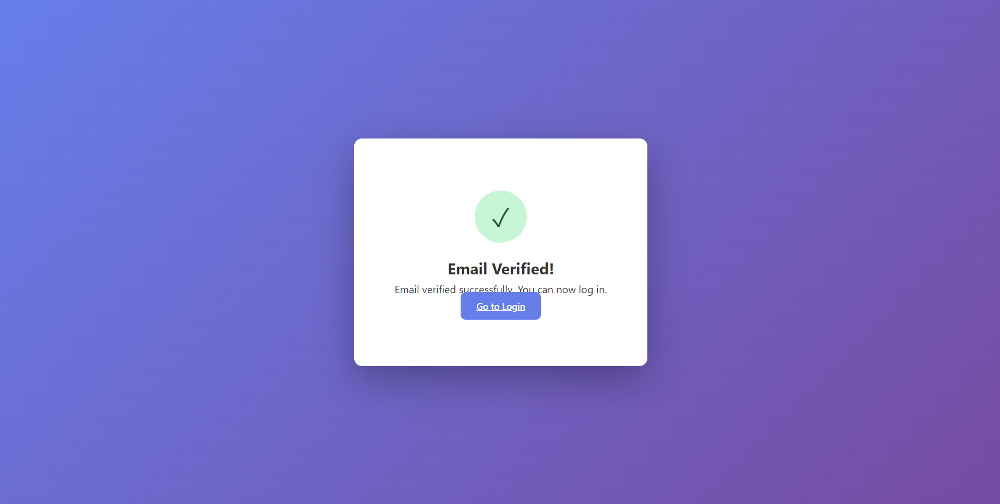
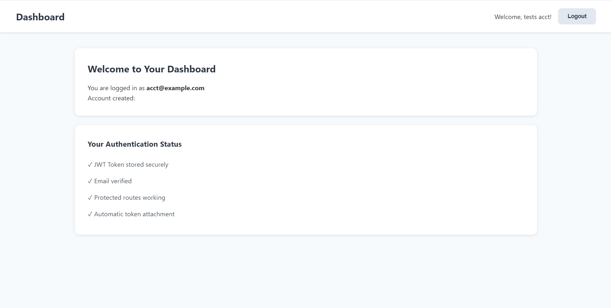

Angular 21 Authentication Frontend

Project Description

This project is a web-based authentication frontend developed using Angular 21. It connects to a Node.js backend API to provide secure user authentication and account management features.

The application allows users to register an account, verify their email address, log in, request a password reset, and access protected pages after authentication.

Features

User Registration – Create a new account using name, email, and password.

Email Verification – Verify user accounts through an email verification link.

User Login – Authenticate users using their registered email and password.

Forgot Password – Request a password reset through email.

Reset Password – Change an account password using a valid reset token.

Protected Routes – Prevent unauthorized users from accessing the dashboard.

Authentication Guards – Redirect authenticated and unauthenticated users appropriately.

HTTP Interceptor – Automatically attach authentication tokens to API requests.

Dashboard – Display the dashboard after successful authentication.

Logout – Clear the authentication session and return to the login page.

Technologies Used

Angular 21

TypeScript

HTML5

CSS3

RxJS

Node.js REST API

JWT Authentication

Project Pages

1. Login Page

Allows registered users to log in using their email and password.

2. Registration Page

Allows new users to create an account.

3. Forgot Password Page

Allows users to request a password reset email.

4. Reset Password Page

Allows users to create a new password using a reset token.

5. Email Verification Page

Verifies a user's account using the verification token received through email.

6. Dashboard Page

Displays the authenticated user's dashboard after successful login.

Installation and Setup

Prerequisites

Make sure the following are installed:

Node.js and npm

Angular CLI

Git (optional)

1. Clone the Repository

git clone YOUR_REPOSITORY_URL

Or open the project folder directly if you already have the source code.

2. Navigate to the Project Folder

cd auth-frontend

3. Install Dependencies

npm install

4. Run the Angular Application

ng serve

5. Open the Application

Open your browser and navigate to:

http://localhost:4200

Backend Connection

This frontend connects to a Node.js backend API running locally.

Make sure the backend server is running before testing authentication features.

Backend URL:

http://localhost:3000

Authentication Testing

The following authentication flows were tested:

User registration

Email verification

Login

Forgot password

Password reset

Protected route access

Logout

Reflections
1. Three main modern Angular features: Signals, standalone components, and lazy loading. Signals simplify reactive state management, standalone components reduce module complexity, and lazy loading improves performance by loading pages only when needed.

2. Signals vs. RxJS: Signals manage reactive state and are simpler for synchronous UI updates. RxJS handles asynchronous data streams, such as HTTP requests. I use Signals for UI state and RxJS for API calls.

3. Auth interceptor and error interceptor: The auth interceptor automatically attaches authentication tokens to requests, while the error interceptor handles API errors consistently, such as unauthorized access or server errors.

4. Route guards: Route guards prevent unauthorized users from accessing protected pages and redirect users to the appropriate page, improving security and navigation experience.

5. Lazy loading: Lazy loading loads components or pages only when needed. It reduces the initial loading time and improves application performance.

6. Single source of truth: My AuthService manages authentication state, user information, and tokens in one central place, preventing inconsistent authentication data across components.

7. Challenges connecting Angular to Node.js: I encountered routing issues, missing dependencies, and frontend-backend connection problems. I solved them by correcting file paths, installing dependencies, configuring routes, and ensuring the API connection was correct.

8. Adding a user profile feature: I would create a profile component, add profile-related methods in the AuthService, connect them to backend API endpoints, and use route guards to protect the profile page.

9. Security considerations: I implemented authentication guards, token-based authentication, HTTP interceptors, password validation, and protected routes. However, localStorage has XSS risks, so stronger token storage and XSS prevention measures are still important.

10. Integrative Programming: This project demonstrates Integrative Programming by combining Angular, TypeScript, HTML, CSS, REST APIs, authentication, and backend services into one functional application.
